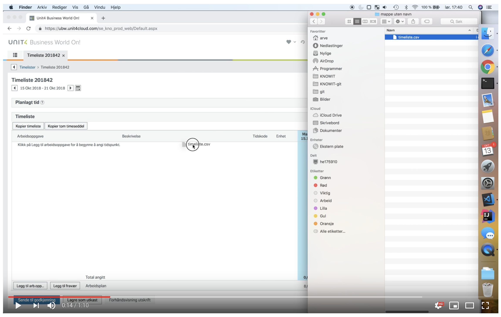

# Unngå UBW

Fyll ut timelisten i UBW, PowerOffice eller SAP med timer fra Toggl, med ett trykk.




## Installere

### Firefox
1. [Trykk på `uubw.xpi`](../../releases/latest/download/uubw.xpi).
2. Godta installasjon og gi tilgang til UBW og `https://api.track.toggl.com/*`.

### Chrome
1. [Last ned `uubw.zip`](../../releases/latest/download/uubw.zip), og pakk den ut til en mappe som blir liggende.
2. Gå til chrome://extensions/.
3. Slå på utviklermodus.
4. Trykk på *Last inn upakket*.
5. Velg mappen du pakket ut.


## Bruk
### Tagger i Toggl
Utvidelsen finner arbeidsordre og aktivitet i taggene på oppføringene i Toggl.

- Tagg oppføringene med `arbeidsordre:nr`.
  `nr` er arbeidsordre i UBW, eksempelvis er administrasjon `40010000-1`.
  Den eldre taggen `timekode:nr` virker fortsatt.
- Hvis oppføringen også skal ha en aktivitet, tagg med `aktivitet:nr`.

Oppføringer med samme arbeidsordre, aktivitet og beskrivelse blir én rad i timelisten.
Oppføringer uten arbeidsordre hoppes over, og du får beskjed om hvilke.
Timene avrundes til nærmeste halvtime.

### Toggl (direkte)
1. Åpne tilvalgssiden (_options page_) for utvidelsen.
   I Firefox går du til `about:addons`, velger _Unngå UBW_ og trykker _Innstillinger_.
2. Lim inn API-nøkkelen fra [profilsiden i Toggl](https://track.toggl.com/profile), og trykk _Lagre_.
3. Velg kundene og prosjektene i Toggl som skal tas med.
   En valgt kunde tar også med prosjekter som opprettes senere.
4. Åpne timelisten i UBW.
5. Trykk _Fyll ut fra Toggl_ ved siden av datospennet for å fylle ut hele timelisten.
   For å fylle ut én dag holder du musepekeren over dagkolonnen og trykker ⤓.
6. Se over timene, og trykk _Lagre som utkast_.

Rader som allerede står i timelisten, fylles ut i stedet for at det lages nye.
Går det en timer i Toggl, stopper utfyllingen til timeren er stoppet.

Toggl gir omtrent 30 kall i timen.
Sparemodus på tilvalgssiden sparer ett kall per utfylling, men oppdager ikke en timer som ble startet før perioden.

### PowerOffice
Utvidelsen kan også fylle ut timelisten i [PowerOffice Go](https://go.poweroffice.net/), med det samme utvalget som for UBW.

- Tagg oppføringene med `po-activity:kode`, og eventuelt `po-project:kode`.
- En oppføring kan ha tagger for både UBW og PowerOffice, og føres da i begge.
- Oppføringer med samme prosjekt og aktivitet blir én rad. Beskrivelsen brukes ikke.

1. Åpne timelisten i PowerOffice, i ukevisningen.
2. Trykk _Fyll ut fra Toggl_ ved siden av uken.
3. Se over timene, og trykk _Godkjenn_ når du er klar.

Hver dag i radene fra Toggl blir lik Toggl, også når det betyr å endre eller slette timer som er ført for hånd.
Rader som ikke finnes i Toggl, røres ikke. Låste dager endres ikke, men du får beskjed hvis de avviker fra Toggl.

#### Fravær i PowerOffice
Sykefravær og permisjon tagges på samme måte, med aktiviteten for fraværet, som `po-activity:903` for «Syk med sykemelding» eller `po-activity:909` for «Helse - lege/tannlege».
Utvidelsen ser selv at aktiviteten er fravær, og fører den fra _Nytt fravær_ i stedet for som en rad.
Fravær kan ikke ha `po-project:`, og ferie og avspasering støttes ikke ennå.

- Sykefravær føres i dager, med timene i Toggl som prosent av normtiden for dagen.
  Prosenten har fire desimaler, så PowerOffice regner seg fram til de samme timene, som 33,3334 % for 2,5 t.
  Dager som henger sammen og har samme prosent, blir ett fravær. Får samme aktivitet flere fravær i uken, får du beskjed, siden hvert fravær med egenmelding teller som én egenmeldingsperiode.
- Permisjon føres i timer, med ett fravær per dag.
- Kommentarfeltet står alltid tomt.

Før fraværene føres, ser du en liste over dem og må bekrefte. Fraværene godkjennes når de føres, slik som når du trykker _Godkjenn_ selv.
Et godkjent fravær må oppheves før det kan slettes, og timene i det kan ikke endres i timelisten.
Derfor endrer eller sletter utvidelsen aldri et fravær som finnes. Dager som har fravær fra før, også opphevet fravær, føres ikke, men du får beskjed hvis fraværet avviker fra Toggl.

### SAP
Utvidelsen kan også fylle ut timelisten i SAP Business ByDesign (`*.sapbydesign.com`), med det samme utvalget.

- Tagg oppføringene med `sap-task:oppgave`, der `oppgave` er oppgaven i kolonnen _Task_, som `100-4093-1`.
- Oppføringer med samme oppgave blir én rad. Beskrivelsen brukes ikke.
- Raden må finnes i timelisten fra før. Oppføringer med en oppgave uten rad hoppes over, og du får beskjed.

1. Åpne _Edit Time Sheet_ i SAP, med _Worklist_ valgt under _View_.
2. Trykk _Fyll ut fra Toggl_ ved siden av «Time Entries from …» for å fylle ut hele uken.
   For å fylle ut én dag trykker du ⤓ ved dagen i kolonnetittelen.
3. Utvidelsen lagrer timelisten. Se over timene, og frigi (_release_) dem selv når du er klar.

Hver dag i radene fra Toggl blir lik Toggl, også når det betyr å endre eller nullstille timer som er ført for hånd.
Rader som ikke finnes i Toggl, røres ikke. Frigitte dager endres ikke, men du får beskjed hvis de avviker fra Toggl.


## Fravær
For fravær i PowerOffice, se [Fravær i PowerOffice](#fravær-i-poweroffice).

I UBW tagger du oppføringen med `arbeidsordre:ABSENCE` for å legge inn fravær.
Beskrivelsen på oppføringen velger typen fravær, og må være _identisk_ med typen i UBW.


## Utvikler
Kjør `npm start`, så åpner Firefox med automatisk reload av plugin. Ved endringer
vil content-scriptet stoppes og oppdateres.

### Publisere
1. Lag [API credentials hos mozilla](https://addons.mozilla.org/en-US/developers/addon/api/key/).
2. Opprett filen *credentials.sh* med *JWT issuer* og *JWT secret*:

```sh
MOZ_API_KEY="user:12345678:90" # JWT issuer
MOZ_API_SECRET="...."          # JWT secret
```

3. Endre versjonsnummer i [manifest.json](./src/manifest.json).
4. Bygg, `npm run build`.
5. Signer, `npm run sign`.
6. Addon er nå i mappen *web-ext-artifacts*.

## Lisens
Copyright Arve Seljebu
