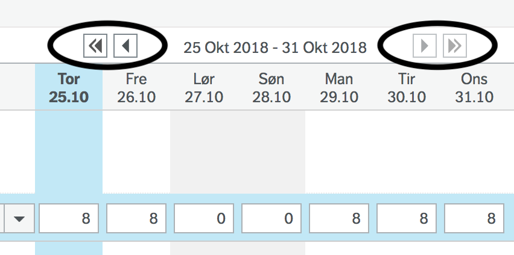

# Unngå UBW

Fyll ut timelisten i UBW med timer fra Toggl, med ett trykk.
Timelisten kan også fylles ut fra en tekstfil med [komma-](https://en.wikipedia.org/wiki/Comma-separated_values) eller [tab-separerte verdier](https://en.wikipedia.org/wiki/Tab-separated_values).


## Installere

### Firefox
1. [Trykk på `uubw.xpi`](../../releases/latest/download/uubw.xpi).
2. Godta installasjon og gi tilgang til UBW og `https://api.track.toggl.com/*`.

### Chrome
1. [Last ned `uubw.zip`](../../releases/latest/download/uubw.zip), og pakk den ut til en mappe som blir liggende.
2. Gå til chrome://extensions/.
3. Slå på utviklermodus.
4. Trykk på *Last inn upakket*.
5. Velg mappen du pakket ut.


## Bruk
### Tagger i Toggl
Utvidelsen finner arbeidsordre og aktivitet i taggene på oppføringene i Toggl.

- Tagg oppføringene med `arbeidsordre:nr`.
  `nr` er arbeidsordre i UBW, eksempelvis er administrasjon `40010000-1`.
  Den eldre taggen `timekode:nr` virker fortsatt.
- Hvis oppføringen også skal ha en aktivitet, tagg med `aktivitet:nr`.

Oppføringer med samme arbeidsordre, aktivitet og beskrivelse blir én rad i timelisten.
Oppføringer uten arbeidsordre hoppes over, og du får beskjed om hvilke.
Timene avrundes til nærmeste halvtime.

### Toggl (direkte)
1. Åpne tilvalgssiden (_options page_) for utvidelsen.
   I Firefox går du til `about:addons`, velger _Unngå UBW_ og trykker _Innstillinger_.
2. Lim inn API-nøkkelen fra [profilsiden i Toggl](https://track.toggl.com/profile), og trykk _Lagre_.
3. Velg kundene og prosjektene i Toggl som skal tas med.
   En valgt kunde tar også med prosjekter som opprettes senere.
4. Åpne timelisten i UBW.
5. Trykk _Fyll ut fra Toggl_ ved siden av datospennet for å fylle ut hele timelisten.
   For å fylle ut én dag holder du musepekeren over dagkolonnen og trykker ⤓.
6. Se over timene, og trykk _Lagre som utkast_.

Rader som allerede står i timelisten, fylles ut i stedet for at det lages nye.
Går det en timer i Toggl, stopper utfyllingen til timeren er stoppet.

Toggl gir omtrent 30 kall i timen.
Sparemodus på tilvalgssiden sparer ett kall per utfylling, men oppdager ikke en timer som ble startet før perioden.

### PowerOffice
Utvidelsen kan også fylle ut timelisten i [PowerOffice Go](https://go.poweroffice.net/), med det samme utvalget som for UBW.

- Tagg oppføringene med `po-activity:kode`, og eventuelt `po-project:kode`.
- En oppføring kan ha tagger for både UBW og PowerOffice, og føres da i begge.
- Oppføringer med samme prosjekt og aktivitet blir én rad. Beskrivelsen brukes ikke.

1. Åpne timelisten i PowerOffice, i ukevisningen.
2. Trykk _Fyll ut fra Toggl_ ved siden av uken.
3. Se over timene, og trykk _Godkjenn_ når du er klar.

Hver dag i radene fra Toggl blir lik Toggl, også når det betyr å endre eller slette timer som er ført for hånd.
Rader som ikke finnes i Toggl, røres ikke. Låste dager endres ikke, men du får beskjed hvis de avviker fra Toggl.

### Toggl (CSV-format)
1. Tagg oppføringene, som beskrevet over.
2. Gå til *Reports* → *Detailed* → Velg tidsperiode, eksempelvis *This Week*.
3. Last ned med knappen oppe til høyre, velg *Download CSV*.
4. Åpne timelisten i UBW.
5. Dra over CSV-filen til UBW.
6. Drikk kaffe og profiiiiiiit.

### Tabseparerte verdier
1. Lag timeliste i [TSV](https://en.wikipedia.org/wiki/Tab-separated_values) eller et regneark.

	```tsv
	;Arbeidsordre	Aktivitet	Beskrivelse     	man	tir	ons	tor	fre	lør	søn
	40010000-1  	-       	Føre timer i UBW	100
	40010000-1  	-       	Drikke kaffe    	  	8
	40010000-1  	-       	Profiiiiiit     	  		8
	ABSENCE     	-       	Lunsj for de med	0,5	0,5	0,5	0,5	0,5
	ABSENCE     	-       	Lunsjpenger     	1 	1 	1 	1 	1
	```

2. Åpne timelisten i UBW.
3. Dra over TSV-filen til UBW.
4. Drikk kaffe og profiiiiiiit.


## Fravær
Bruk arbeidsordre `ABSENCE` for å legge inn fravær. Beskrivelsen brukes til å
velge riktig type fravær. Beskrivelsen må være _identisk_ lik den du finner i UBW.


## Filformat
### CSV
Første linje brukes for å velge kolonner. Felt i bruk er `Description`, `Start date`, `Duration` og `Tags`.

Eksempeleksport fra toggl:
```csv
User,Email,Client,Project,Task,Description,Billable,Start date,Start time,End date,End time,Duration,Tags,Amount (USD)
Ditt Navn,din@epost.no,,,,beskrivelse1,No,2019-04-01,08:00:00,2019-04-01,08:15:00,00:15:00,"timekode:40010000-1",
Ditt Navn,din@epost.no,,,,beskrivelse2,No,2019-04-01,08:15:00,2019-04-01,08:30:00,00:15:00,"timekode:40010000-3",
```

Hvis en ønsker lage CSV selv, vil CSV være:
```csv
Description,Start date,Duration,Tags
beskrivelse1,2019-04-01,00:15:00,"timekode:40010000-1"
beskrivelse2,2019-04-01,00:15:00,"timekode:40010000-3"
```

### TSV
- Linjer som starter med `;` blir ignorert.
- Verdiene er separert med tab.
- La arbeidsordre som ikke har aktivitet være tom, eller bruk `-`.
- Timene blir fylt en kolonne av gangen. Det vil si at første kolonne vanligvis
  er mandag, så kommer tirsdag, osv.
- Mellomrom før og etter verdier blir fjernet.

#### Korte og lange uker
Noen uker er ekstra lange. Eksempelvis uke 43 i 2018, som er fra 22. oktober til 31. oktober.
For lange uker trengs ekstra kolonner for å føre timene:

```tsv
;arbordre	aktivitet	beskrivelse	man	tir	ons	tor	fre	lør	søn	man	tir	ons
40010000-1	-       	Lese epost	8	8	8	8	8			8	8	8
```

Når timene føres vil de ikke bli synlig. En må navigere seg i kalenderen
for å kontrollere timene for alle dagene:



Tilsvarende blir det for kort uke, bare med færre kolonner i TSV-filen. Om en fører i
for mange kolonner, vil UBW vise summen, men når en lagrer valideres og korrigeres
timelisten.

### Konvertere fra CSV til TSV
Om du ønsker å summere og legge sammen timer fra Toggl, kan det gjøres med
scriptet [toggl_til_tsv](./toggl_til_tsv):

```sh
$ ./toggl_til_tsv ~/Downloads/Toggl_time_entries_2019-11-18_to_2019-11-24.csv
Legge til 0,5t lunsj og lunjspenger for dagene du har jobbet? [y/n]: y
timeliste-2019-48.tsv created
Deleting /Users/arve/Downloads/Toggl_time_entries_2019-11-18_to_2019-11-24.csv
```


## Utvikler
Kjør `npm start`, så åpner Firefox med automatisk reload av plugin. Ved endringer
vil content-scriptet stoppes og oppdateres.

### Publisere
1. Lag [API credentials hos mozilla](https://addons.mozilla.org/en-US/developers/addon/api/key/).
2. Opprett filen *credentials.sh* med *JWT issuer* og *JWT secret*:

```sh
MOZ_API_KEY="user:12345678:90" # JWT issuer
MOZ_API_SECRET="...."          # JWT secret
```

3. Endre versjonsnummer i [manifest.json](./src/manifest.json).
4. Bygg, `npm run build`.
5. Signer, `npm run sign`.
6. Addon er nå i mappen *web-ext-artifacts*.

## Lisens
Copyright Arve Seljebu
